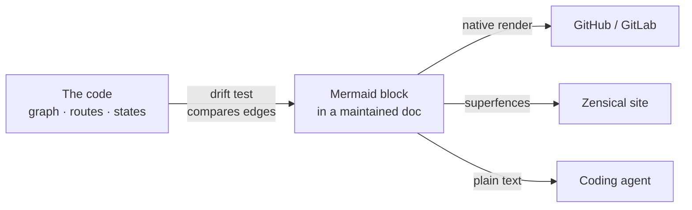

# Diagrams

Every diagram in `docs/` is a **Mermaid** block. This holds in every repo the skill sets up,
with or without the reader layer or a site.

## Why Mermaid, and only Mermaid

- **It is text.** A diagram change shows up in the diff, gets reviewed with the code that
  caused it, and an agent can read and edit it like any other paragraph.
- **It renders where the docs are read.** GitHub and GitLab render a ```` ```mermaid ````
  fence natively, and Zensical renders it through one config line (`references/site.md`).
  The same file works in both places with no build step.
- **It can be tested.** A test can parse a Mermaid block and compare its edges to the code
  (see the drift test below). Nothing can test a picture.

An image of a diagram (`.png`, `.svg`, a draw.io export) is a copy nobody updates: the
source file is elsewhere, and the diff is a binary blob. The gate already fails an image
file under `docs/` as an unexpected file type, so the rule holds without a new check.
`conventions/documentation.md` states it as a rule, so the failure has an explanation.



## One legend, defined once

Colour nodes by the answer to **one question** that matters to the readers. Define the
classes once in `conventions/documentation.md`, then paste the same `classDef` lines at the
end of every diagram. A colour that means one thing on one page and something else on the
next is worse than no colour.

Choose the question by asking what readers most often get wrong about the system:

| Kind of system | The question | Typical classes |
| --- | --- | --- |
| LLM product | Who produces the text the user reads? | `llm_call` (a model call), `llm_text` (text a model writes), `code` (deterministic code, fixed text included) |
| Service / backend | Who owns this box? | `ours`, `external` (a third-party API), `store` (a database or queue) |
| Data pipeline | How does this step run? | `batch`, `stream`, `manual` |
| Evaluation harness | Is this the thing being measured? | `subject` (the system under test), `harness` |

The LLM legend, as an example of the shape every legend takes:

```text
classDef llm_call fill:#fdecea,stroke:#c62828,color:#000
classDef llm_text fill:#fff8e1,stroke:#f9a825,color:#000
classDef code fill:#e8f0fe,stroke:#1a73e8,color:#000
```

| Class | Colour | Node is |
| --- | --- | --- |
| `llm_call` | red | an LLM call |
| `llm_text` | yellow | text a model writes to the user, a fixed text it copies word for word included |
| `code` | blue | deterministic code, a fixed text the code appends or sends itself included |

State the edge cases in that table, not in each diagram. In the LLM legend, a fixed text the
model is *told* to copy is still `llm_text`: the colour says who produces the bytes, however
strictly the prompt asks for them.

Set `color:#000` on every class. Light fills with black text stay readable in a dark theme.
Group with `subgraph` and `style <id> fill:none,stroke:#888`, which keeps the frame neutral.

## Which diagrams to draw

A diagram earns its place when it shows a **mechanism**: an order, a branch, an owner.
A box per module with arrows to every other box shows nothing. Three diagrams cover most
projects. They belong on the overview page (`references/reader-layer.md`):

| Diagram | Answers | Mermaid |
| --- | --- | --- |
| **Where it runs** | What talks to what: the system, its hosts, its external dependencies | `flowchart TB` with one `subgraph` per platform |
| **The user's journey** | The path a user takes through the product, with its branches | `flowchart TD`, edge labels for the user's choice |
| **One unit of work** | One request, turn or job end to end: every step, and which ones decide | `flowchart TD`, or `sequenceDiagram` when the timing matters |

A deep dive adds one to three diagrams of its own feature, with the same legend.

Keep labels short: `<br/>` for a second line, quotes around any label with punctuation.
A label carries the name a reader will search for, so put the code's own name in it
(`route_request`) when the deep dive cites that symbol.

## The drift test

A diagram that loses an edge, or keeps one the code no longer has, sends a reader looking
for a path that does not exist. Review does not catch it, because nobody re-reads a diagram
when the code changes.

Write one test **when the code exposes its topology as data**: a graph's declared edges, a
router's table, a state machine's transitions, a DAG definition. Point it at the central
diagram, usually "one unit of work":

1. Put a marker comment right before the fence (`<!-- request-diagram -->`), so the test finds
   the right block on a page that holds several.
2. Map each diagram id to the code's name in an explicit dict. An id missing from the map is
   a box that is not a real node (a branch, a terminal, a legend), and the test ignores it.
3. Parse the edges. For each line with `-->`, take the **leading** id on each side, so a
   node's label never contributes a token. Split the right side on `&`.
4. Assert three things: every edge the code declares is drawn, every edge drawn is
   declared, and every node the code registers appears in the map.

Compare **edges only**, never the layout or the labels. A test that pins the shape fails on
every honest redraw, and it gets deleted.

A skeleton in Python with pytest. Only `declared_edges()` and `ID_TO_NODE` are
project-specific:

```python
import re
from pathlib import Path

DOC = Path(__file__).resolve().parents[1] / "docs" / "README.md"
MARKER = "<!-- request-diagram -->"
#: Diagram id -> the code's name. Ids absent here are not nodes, and are ignored.
ID_TO_NODE = {"R": "route_request", "A": "authorize", "H": "handle"}
LEADING_ID = re.compile(r"\s*([A-Za-z][A-Za-z0-9_]*)")


def declared_edges() -> set[tuple[str, str]]:
    """The topology as the code declares it: a graph, a route table, a state machine."""
    from app.router import GRAPH  # project-specific

    return {(source, target) for source, targets in GRAPH.items() for target in targets}


def drawn_edges() -> set[tuple[str, str]]:
    body = DOC.read_text(encoding="utf-8")
    start = body.index("```mermaid", body.index(MARKER))
    block = body[start : body.index("```", start + len("```mermaid"))]
    edges = set()
    for line in block.splitlines():
        if "-->" not in line:
            continue
        left, right = line.split("-->", 1)  # `A & B --> C & D` draws four edges
        for source in map(node_at, left.split("&")):
            for target in map(node_at, right.split("&")):
                if source and target and source != target:
                    edges.add((source, target))
    return edges


def node_at(text: str) -> str | None:
    hit = LEADING_ID.match(text.split("|")[-1])  # skip an `-->|label|` prefix
    return ID_TO_NODE.get(hit.group(1)) if hit else None


def test_every_declared_edge_is_drawn() -> None:
    assert not declared_edges() - drawn_edges()


def test_no_edge_is_invented() -> None:
    assert not drawn_edges() - declared_edges()


def test_every_node_is_mapped() -> None:
    assert set(ID_TO_NODE.values()) == {node for edge in declared_edges() for node in edge}
```

When the topology is not machine-readable, there is no drift test. The diagram is then
reviewed node by node against the code, as part of the definition of done in
`references/reader-layer.md`.
