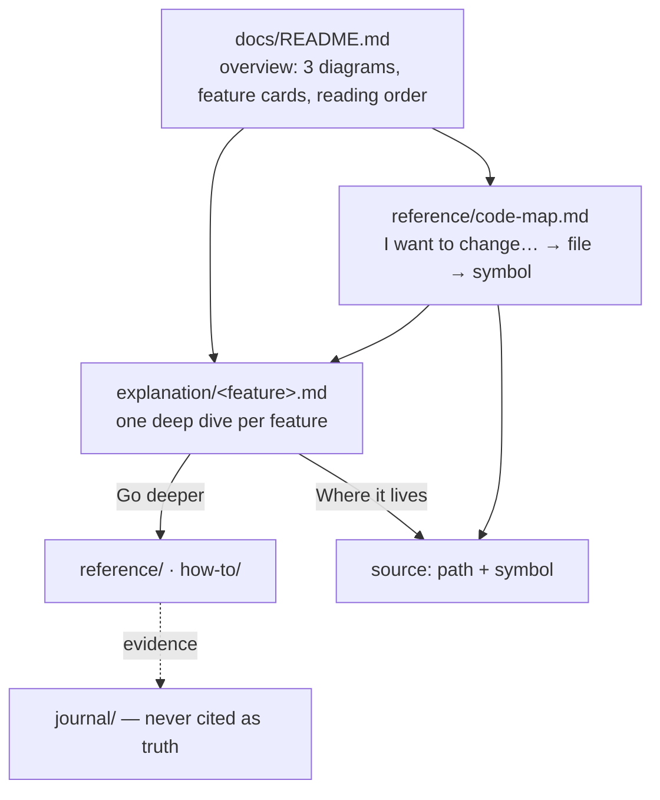

# The reader layer

The taxonomy answers the **writer's** question: where does this paragraph go? It does not
answer the **reader's**: how does this feature work, and where do I change it? A tree that
places every paragraph correctly can still be unreadable. Pages are written for an agent,
one is 500 lines long, and nothing links a behaviour to the file that implements it.

The reader layer adds four page shapes inside the existing folders. It adds no folder and
no gate rule, and the routing rule stays the same.

## When to add it

Add the layer when **one** of these holds:

- people read the docs without changing the code: a PO/PM, a data scientist, support, a
  new hire;
- `explanation/` holds pages longer than the prose cap, written as notes for an agent;
- the same question keeps coming up ("where does X get decided?") and no page answers it.

Do not add it to a greenfield repo. A project with fewer than three features to explain has
nothing for an overview to route between. Start with the taxonomy, and add the layer when
the third explanation page appears.

The layer and a published site are separate decisions. The layer works on GitHub as plain
Markdown, since GitHub renders Mermaid. A site (`references/site.md`) adds search and
navigation on top.

## Name the readers

Write the readers into `conventions/documentation.md`, by role, before writing any page:
*"the PO/PM, who needs to know what a feature does and what the user sees; the developer,
who needs to change it."* Every rule below splits a page between them. Without named
readers, every page drifts back to being written for its writer.

Two readers is the common case: one who needs **what it does**, one who needs **how to
change it**. A third reader with a separate need, such as an evaluator, usually belongs in a
separate tree.

## The four page shapes

### 1. The overview: `docs/README.md`

The home page is for a reader, not a writer. It holds, in order:

1. **What the product is, in one paragraph**: who uses it, what it does, the one
   architectural fact a reader must hold (for example, "the code, never the model, writes
   to the database").
2. **The legend**, one sentence.
3. **Three diagrams**: where it runs, the user's journey, one unit of work. They are
   specified in `references/diagrams.md`.
4. **Feature cards**: one per deep dive, each a link plus two lines. The code map and the
   two or three most used reference or how-to pages get a card as well.
5. **A reading order** for a newcomer: three or four deep dives, numbered.
6. **One line pointing writers at `conventions/documentation.md`.**

The routing rule and the folder table move out of `README.md` into
`conventions/documentation.md`. The agents section keeps its own copy of the compass, so an
agent still places a paragraph without a second read.

The **index** moves too:

| Setup | The index the gate checks | Change in the gate |
| --- | --- | --- |
| No site | An `## All pages` section at the bottom of the overview, one link per maintained doc, grouped by folder | None |
| A site | The `nav` of `zensical.toml` | `SITE_CONFIG` (`references/site.md`) |

The cards are curated and the index is exhaustive. Keep both.

Template: `templates/docs-overview.md`.

### 2. The deep dive: `explanation/<feature>.md`

There is one deep dive per **feature**: a behaviour a reader can name ("checkout", "search",
"permissions"), not a module. It follows a fixed template, with six sections
always in this order:

| Section | Holds | For |
| --- | --- | --- |
| *(title + one-line `>` quote)* | What the feature is for, in one sentence | both |
| `## At a glance` | One to three Mermaid diagrams, with the site-wide legend | first reader |
| `## How it works` | Short bullets, one claim each, no paragraph over four lines | first reader |
| `## What the user sees` | Two or three **real** outputs, copied from a run, in a fence | first reader |
| `## Where it lives` | Table: behaviour → file → symbol | second reader |
| `## How to change it` | Table: "I want to…" → file → the test or command that guards it | second reader |
| `## Go deeper` | Links to `reference/`, `how-to/`, and the ADRs | both |

The top half serves the reader who needs what it does, and the bottom half the reader who
changes it. Keep the section names, so a reader who has read one deep dive can navigate
them all.

**Prose cap: 150 lines.** Tables, diagrams and code blocks do not count, which is why a deep
dive can run to 300 lines and still be under the cap. The gate warns past it.

**"What the user sees" is real.** It holds a message, a response, a CLI output or a screen
state, copied from an actual run, in the product's language. An invented example teaches
the reader a behaviour the product does not have.

**A deep dive replaces pages and does not add to them.** When a deep dive absorbs an
existing explanation page, delete that page in the same commit and repoint its links. A
deep dive written next to the page it summarises is a second copy.

**A deep dive links and does not restate.** A parameter table belongs in `reference/`, and a
procedure belongs in `how-to/`. The deep dive links both under "Go deeper".

Template: `templates/deep-dive.md`.

### 3. The code map: `reference/code-map.md`

The code map turns "I want to change X" into a file and a symbol. It is a reference page
with two parts:

1. **Packages**: one row per package in the order a request crosses them, giving what it
   holds (one to three sentences naming the main files and symbols) and the layer invariant
   that applies (`Never imports src/agent/`, `No I/O`).
2. **I want to change…**: grouped by theme (fixed texts, prompts, rules, thresholds,
   integrations). The columns are *I want to change…* → *File* → *Symbol or key* →
   *Read* (the deep dive) → *Guarded by* (the test).

Fill the second part from the questions people really ask. A row nobody needs is noise
that someone still has to keep true.

Template: `templates/code-map.md`.

### 4. Diagrams

Diagrams are part of the base taxonomy rather than this layer, and `references/diagrams.md`
holds the rules. The layer puts them to work: three on the overview, one to three per deep
dive, all with the same legend.

## Citing code

Cite code as a backticked `path` plus its `symbol`, such as `src/agent/graph.py`
`create_graph`. Never cite a line number, which goes stale on the next edit above it.

| Setup | Form | Why |
| --- | --- | --- |
| No site | A link to the file is fine, with the symbol named in the text | The gate resolves the link, so a renamed file fails |
| A site | Backticks only, never a link out of `docs/` | The site publishes `docs/` alone, so the link would be dead. The gate enforces it with `LINKS_STAY_IN_TREE` |

A backticked path is not resolved by the gate, so the definition of done checks it.

## Doing it on a brownfield repo

The layer is a rewrite of `explanation/`, so plan it as one PR per batch of features, not as
one big PR.

1. **Collect the findability set first.** Gather about ten questions real readers asked,
   from the owner, the issues, or the chat history: *"where is the welcome email written?"*,
   *"why was the user not asked for their address?"*. This set is the acceptance test, and writing it
   first keeps the pages aimed at it.
2. **List the features**, one deep dive each. Map every existing `explanation/` page onto
   one of them: absorbed, kept as reference, or moved to the journal.
3. **Write the overview and move the writer rules out of it.** Do this in a single commit,
   so the routing rule always exists somewhere.
4. **Write the code map.**
5. **Write the deep dives**, deleting each absorbed page in the same commit (`git rm`, then
   repoint every link).
6. **Add the drift test** for the central diagram, when the topology is machine-readable
   (`references/diagrams.md`).
7. **Run the definition of done** on the result.

## Definition of done

The layer is done when these three checks pass. Put their results in the PR description.

1. **Findability.** For each question in the set, record the answer's page and the path to
   it. The answer is reachable in **at most three clicks from the overview, or one search**.
   A question that fails gets a card, a code-map row, or a sharper deep-dive title. It does
   not get a new page.
2. **Checked against the code.** Every diagram is checked **node by node and edge by edge**,
   and every cited `path` and `symbol` exists. Grep each one; a renamed symbol is the
   commonest error.
3. **Prose budget.** Compare the prose lines of `explanation/` before and after, with
   `prose_lines()` from the gate. Expect the **total** line count to grow, since the layer
   adds diagrams and tables (often by a third or more). The **prose** count is
   the one that should shrink, or stay flat. Every page must stay under its cap.
