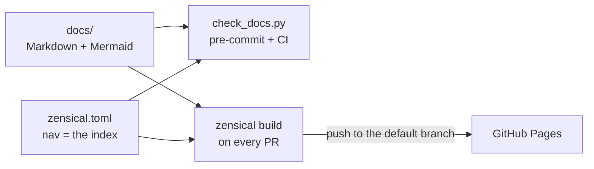

# Publishing a site (optional)

A site adds **search and navigation** for readers who do not browse the repository. It
changes nothing in the taxonomy: the folders, the frontmatter, the journal and the gate stay
as they are. Two things move: the index becomes the site's `nav`, and maintained docs stop
linking out of `docs/`.

**Zensical** is the reference choice. It comes from the team behind MkDocs + Material, reads
the same Markdown, and renders Mermaid through one config line. Any generator with an
explicit nav works the same way; only `nav_paths()` in the gate needs porting.



## When to build one

| Situation | Site? |
| --- | --- |
| Readers who do not clone the repo (PO/PM, support, another team) | Yes |
| The reader layer is in place and readers ask for search | Yes |
| Only developers and agents read the docs | No. GitHub renders the Markdown and the Mermaid, and an agent greps |
| No reader layer yet | Not yet. A site over agent-shaped pages is a searchable version of the same problem |

Ask the owner (`references/decisions.md`, question 5), then record the choice in an ADR.

## Setup

1. **`zensical.toml` at the repository root**, from `templates/zensical.toml`, with
   `docs_dir = "docs"`. Pin the version in the project's dependencies. Zensical is at 0.0.x,
   so its behaviour can change between minor versions.
2. **List every maintained doc in `nav`.** The nav is the index now: drop the `## All pages`
   section from the overview. Put `README.md` first, as the home page. Group the pages by
   the reader's question, not by the folder. A "Features" section holds the deep dives,
   and the folders become the other sections.
3. **Keep `journal/` out of the nav, but build it.** A maintained doc links its ADRs, so the
   pages must exist on the site. Copy `templates/journal-meta.yml` to `docs/journal/.meta.yml`
   with `[project.plugins.meta]` enabled. That excludes every entry from search, because the
   journal is never cited as truth. The gate skips hidden files, so `.meta.yml` passes.
4. **Switch the gate**, in its CONFIGURATION block:

   ```python
   SITE_CONFIG = REPO_ROOT / "zensical.toml"   # the nav is the index
   LINKS_STAY_IN_TREE = True                   # cite code in backticks, not links
   ```

   The gate then fails a maintained doc missing from the nav, a nav entry with no file, and
   a link from a maintained doc that leaves `docs/`. Widen the pre-commit hook to
   `files: ^(docs/|zensical\.toml$)`, so an edit to the nav alone runs the gate.
5. **Build on every PR** (`zensical build --clean`), so a broken build fails the PR that
   broke it. **Publish** on push to the default branch with the workflow Zensical documents
   (`zensical new` creates it). Set the repository's Pages source to "GitHub Actions". For a
   private repository, check that the organisation's plan allows private Pages before you
   promise the readers access.
6. **Add `make docs-serve` and `make docs-build`** (or the project's equivalent), and name
   them in `conventions/documentation.md`.
7. **Ignore the build output** (`/site/`) in `.gitignore`.

## Rules worth knowing

**Leave strict mode off.** `strict = true` fails the build on any link it cannot resolve,
including journal links that leave the tree. Plans and specs cite repo files, and those
links are records. The gate already resolves every link with the repository's semantics, so
strict mode adds only false failures.

**A link out of `docs/` is dead on the site.** The site publishes `docs/` and not the
repository, so `../../src/app.py` builds into a 404. Cite the path in backticks with its
symbol (`references/reader-layer.md`, *Citing code*). The gate enforces this for maintained
docs, while journal entries stay free to link out.

**Feature cards need `md_in_html`.** The `<div class="grid cards" markdown>` block on the
overview renders as cards on the site and as a plain list on GitHub. Both read fine, so
nothing breaks when the same file is read in either place.

## Several docs trees, one site

A sub-project with its own `docs/` (`packages/<project>/docs/`) can join the site under its
own tab. Zensical reads a single `docs_dir` and **does not follow a symlinked directory**: a
symlinked tree builds a site without its pages. So:

- A script copies every tree into a git-ignored `docs_dir` (the root tree at the top, each
  sub-tree under its mount point), and the build runs on the copy. `make docs-serve` re-runs
  it on each change (with `watchfiles`, for example).
- The gate keeps reading the source trees. Its nav check maps each nav entry back through
  the mount point, and the confinement rule confines a doc to **its own** tree.
- Discover the trees from the filesystem (`packages/*/docs/`) instead of listing them. A
  listed tree is one a new sub-project forgets to join.

The shipped gate checks one tree. Treat the multi-tree version as a deliberate adaptation
of the copied script, with tests for the assembly. It is not a CONFIGURATION switch.

Optional: the copy step can add a search tag per folder to each page's frontmatter
(`Reference`, `How-to`), so search can be filtered by quadrant. The sources stay untagged.
