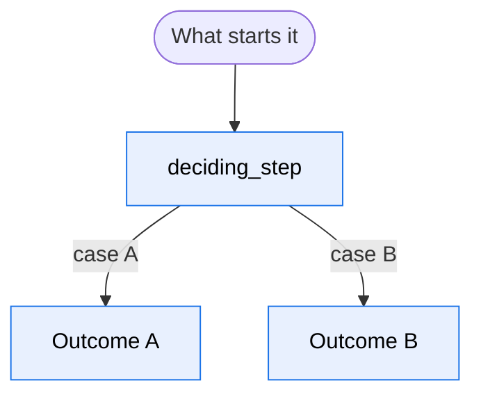

# {{Feature}}

> {{One sentence: what this feature is for, in the user's terms.}}

<!-- The template: six sections, in this order, with these names. "At a glance", "How it
     works" and "What the user sees" serve the reader who needs what it does; "Where it
     lives" and "How to change it" the reader who changes it; "Go deeper" both. 150 prose
     lines at most; tables, diagrams and code blocks do not count. -->

## At a glance



## How it works

- {{One claim per bullet. The rule or the fact first, the mechanism after.}}
- {{No paragraph over four lines. A third case in one sentence becomes a table.}}

## What the user sees

{{Two or three real outputs, copied from an actual run, in the product's language: a
message, a response body, a CLI output. Never invented.}}

```text
{{a real output}}
```

## Where it lives

| Behaviour | File | Symbol |
| --- | --- | --- |
| {{what happens}} | `{{src/path/file.py}}` | `{{function_or_class}}` |

## How to change it

| I want to… | File | Guarded by |
| --- | --- | --- |
| {{change the threshold}} | `{{src/path/file.py}}` `{{CONSTANT}}` | `{{tests/path/test_file.py}}` |

## Go deeper

- [Code map](../reference/code-map.md): every package, and the file behind each change.
- {{[`reference/<page>.md`](../reference/page.md): the full contract.}}
- {{[`how-to/<page>.md`](../how-to/page.md): the procedure.}}
- {{[ADR NNNN](../journal/decisions/NNNN-title.md): why it is built this way.}}
