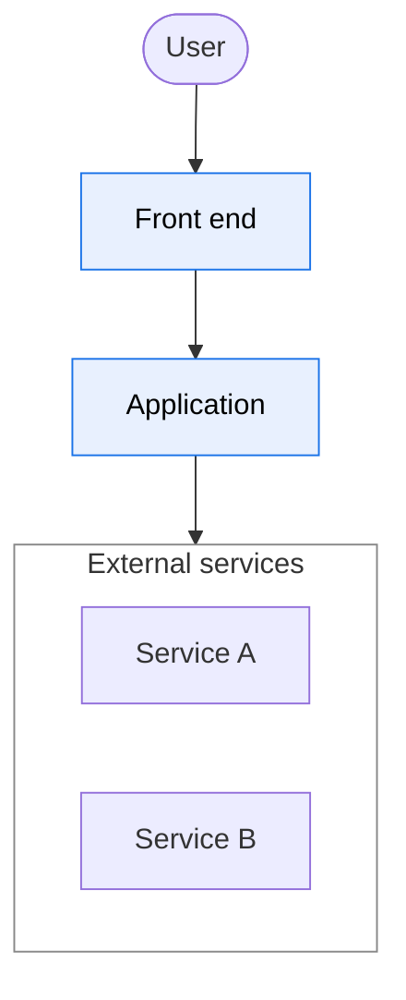
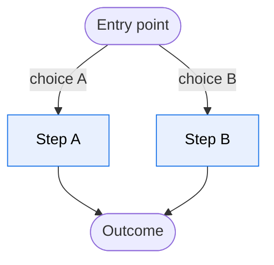
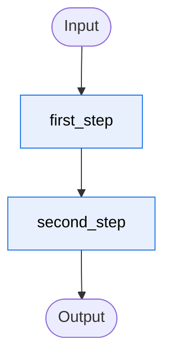

# {{Project}} at a glance

{{One paragraph. Who uses the product, what it does for them, and the one architectural fact
a reader must hold before anything else, such as "deterministic code prepares the request,
one model writes the reply, and code closes it".}}

**Legend:** {{one sentence per class, from `conventions/documentation.md`, for example: red
for an LLM call, yellow for text the model writes to the user, blue for deterministic
code}}.

## Where {{Project}} runs

## The user's journey

## One {{request / turn / job}}

<!-- {{unit}}-diagram -->

## Features

- **{{[Feature](explanation/feature.md)}}**

    {{Two lines: what the feature does, and the question this page answers.}}

- **[Code map](reference/code-map.md)**

    Where each package lives, and the file to open to change a text, a rule or a
    threshold.

**New here?** {{Read the deep dives in this order: 1 [first](explanation/first.md) →
2 [second](explanation/second.md) → 3 [third](explanation/third.md).}}

## All pages

{{WITHOUT A SITE ONLY. With a site, the `nav` of `zensical.toml` is the index: delete this
section.}}

Every maintained doc is listed here, and a doc missing from the list fails CI.

- `explanation/`: {{[feature](explanation/feature.md)}}
- `how-to/`: {{[do a thing](how-to/do-a-thing.md)}}
- `reference/`: [code map](reference/code-map.md)
- `conventions/`: [documentation](conventions/documentation.md)

Writing a page? The rules are in [`conventions/documentation.md`](conventions/documentation.md).
